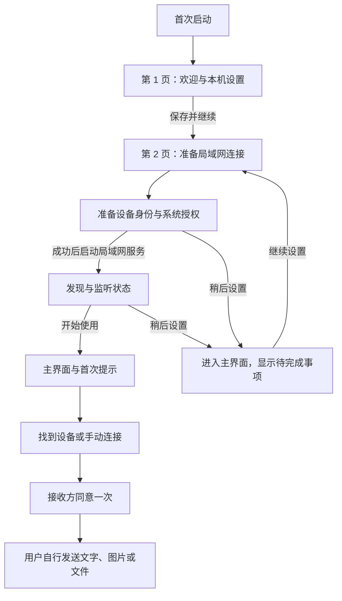

# 飞鸽快传首次安装引导方案

方案版本：1.0 · 整理日期：2026-10-24 · 状态：待实现与体验验收

本方案规定 macOS 与 Windows 第一次启动应用时的共同体验，权威版本与两端源码一同在统一 `main` 主线上维护。它是后续设计与开发依据，不代表两端已完成接入。共同约束见[开发总则](DevelopmentRules.md)、[UI 与交互同步规范](UISpecification.md)和[应用更新规则](UpdatePolicy.md)。

## 1. 目标与范围

首次引导帮助用户回答四个问题：别人如何认出这台电脑、收到的文件放在哪里、为何出现系统授权、如何开始第一次互传。采用“两页引导 + 主界面首次提示”，不强制走完真实收发，不新增注册、登录、配对码或逐文件审批。

应用安装完成与首次引导分别处理：安装器只完成安装并允许用户选择启动；首次引导在应用窗口中进行，不由安装器创建通信身份、选择接收目录或集中申请权限。Windows 正式 EXE 的正常使用不应要求用户安装开发工具或打开开发者模式。

首轮以约一分钟完成本机设置为体验目标，不设用户操作倒计时；系统授权、目录选择和网络环境耗时不计为必须达成的性能承诺。没有互联网、没有另一台设备或不允许通知，都能完成本机引导。

## 2. 总体流程

流程图中的身份与网络步骤按顺序执行，不把系统弹窗堆在一起。“稍后设置”只跳过尚未完成的连接准备，不绕过身份检查、系统权限或连接同意。

## 3. 第 1 页：欢迎与本机设置

采用紧凑的单列布局，使用已确认的 v1 图标和平台原生表单。顶部显示“欢迎使用飞鸽快传”，说明“同一局域网内，轻松互传文字、图片和文件。无需注册，对方同意连接后即可开始。”

| 内容 | 设计与规则 |
| --- | --- |
| 设备名称 | 默认读取系统可读的电脑名称，用户可直接修改；说明“同一局域网中的设备会看到这个名称”，避免用户误填账号或密码 |
| 名称校验 | 与共同规范一致：去首尾空白后 1–48 个字符、最多 128 个 UTF-8 字节，无控制字符；系统默认名也须规范化，必要时按字符边界截断；错误在输入框附近显示 |
| 接收位置 | 新用户建议统一为系统“下载”目录下的“飞鸽快传”文件夹；使用系统目录 API 获取位置，不拼接固定英文路径；显示真实路径并提供“更改…” |
| 位置说明 | “收到的文件保存在这里，同名文件不会被覆盖。以后可在设置中更改。”长路径允许截断显示并提供完整可访问文本 |
| 更新偏好 | “自动检查更新”默认开启；紧邻说明“会联网获取版本信息，下载和安装前会询问”；遵循应用更新规则，不新增强制联网测试 |
| 主要操作 | “保存并继续”；保存过程中避免重复提交，成功后进入第 2 页 |
| 退出操作 | 窗口关闭时退出首次引导并停止本次初始化；下次继续。此时尚未启用后台收发，不套用正常使用后的后台驻留行为 |

本页不展示完整设备指纹，不要求用户理解密钥、协议、端口或证书；设备指纹仍可在设置的安全详情中查看。无需新增协议勾选框；若未来涉及正式隐私政策或条款，另行确定内容与展示规则，不使用空链接或虚假“已同意”状态。

用户点击“保存并继续”前，只读取必要的本机配置与系统目录信息，不触发会要求钥匙串授权的身份操作，不启动网络广播、监听或版本检查。目录选择使用系统选择器；取消选择保留原值。

提交时先验证并保存设备名称、接收目录和更新偏好，再推进流程。验证目录可创建且可写，使用独立临时探针并清理，不覆盖任何已有文件。若目录访问触发系统询问，应在操作前就地说明原因。系统下载目录不存在或不可用时请用户另选位置，不默默退回整个用户目录。

新默认接收位置只用于真正新用户；不得迁移或重命名已有用户目录，也不得替换现有设置。macOS 当前默认 `Downloads/Feige Received`、Windows 当前默认“文档/飞鸽快传”均继续保留给原有用户。

## 4. 第 2 页：准备局域网连接

页面标题为“准备连接”，说明“飞鸽快传需要识别本机并访问局域网。接下来可能出现系统授权，请按实际需要选择。”本页显示三个状态项，使用文字与图标共同表达状态，不用虚构进度百分比。

| 状态项 | 用户可见状态 | 成功的依据 |
| --- | --- | --- |
| 本机身份 | 正在准备／等待系统授权／已就绪／需要处理 | 身份读取或创建成功，真实签名及验签通过 |
| 接收位置 | 检查中／可以保存文件／需要更改 | 实际目录创建与写入检查通过；仅代表检查时可用 |
| 局域网连接 | 等待身份准备／正在启动／查找附近设备／需要处理 | 监听与发现服务的实际启动结果；不以“找到另一台设备”作为成功条件 |

推荐操作顺序：先完成身份预检；成功后在页面已说明用途的前提下启动局域网服务，引出系统可能需要的局域网或防火墙授权。接收目录沿用第 1 页检查结果，需要时复核；不重复诱发权限弹窗。系统弹窗进行中，应用自身界面保持可响应，并显示正在等待什么。

- 正常完成：主按钮“开始使用”，进入主界面；没有发现设备也可以继续。
- 等待或失败：提供当前问题的“重试”“更改位置”或“打开设置指引”，另有“稍后设置”。不能把拒绝授权当成程序崩溃或显示假的绿色成功。
- 稍后设置：可进入主界面查看说明和设置；必要的身份、接收位置或网络条件未满足时，首版不开放新连接与收发能力。保存已完成配置，以醒目但不反复弹窗的提示引导继续。
- 返回修改：第 2 页进入主界面前可返回第 1 页。先停止已启动的发现与监听并取消本轮等待，再保存新值并重新准备；已创建身份继续复用。
- 关闭窗口：首次引导尚未结束时退出本次引导，清理服务并取消等待。晚到的异步结果不能继续弹窗、开启监听或把流程标为完成。

允许用户进入主界面代表“引导已看完或已选择稍后处理”，不等于连接能力已就绪。身份签名、目录写入、网络启动、实际跨设备互通分别表示，不能合并成“全部权限已授权”。

用户已经选择“开始使用”或“稍后设置”后，从主界面进入“继续设置”属于问题修复，不能重新设为首次引导未结束；此时窗口关闭仍遵循正常后台运行规则，离开修复视图会取消该视图触发的等待与重试，不中断此前已正常运行的服务。

## 5. 系统权限的差异与提示时机

| 平台／能力 | 出现时机与说明 | 拒绝或不可用后的行为 |
| --- | --- | --- |
| macOS 钥匙串 | 第 2 页准备身份时按系统实际行为出现；说明“系统可能要求验证 Mac 登录密码，以使用本机设备身份” | 不读取或保存密码；用户可按系统提供的选项决定是否持续允许；取消后可重试，身份未就绪前禁止收发，不重新生成密钥来绕过授权 |
| macOS 局域网 | 启动相关网络操作时按系统版本出现；说明“用于查找附近设备并与其连接” | 按实际错误展示恢复指引，可指导到“系统设置 → 隐私与安全性 → 本地网络”；无可靠查询能力时显示“连接未就绪”，不猜测用户已经拒绝 |
| Windows 本机身份 | 由系统保护的本机身份存储与签名预检完成，通常无需单独做权限教学页 | 解密、读取或签名失败时显示修复与重试入口；不展示虚假的 Mac 式密码框，不静默重置身份 |
| Windows 防火墙 | 启动监听等网络行为时，系统可能提示；说明“用于允许其他设备连接此应用”，由用户按可信网络环境选择 | 只指导允许应用，不指导关闭防火墙或无差别放行所有网络；受单位策略限制时说明可能需要管理员协助，不擅自更改网络类型或防火墙规则 |
| 接收目录访问 | 在用户确认目录或更改目录时按实际需要触发 | 保留原选择并允许更改；不索取整盘访问来替代目录权限 |
| 系统通知 | 从必经引导移除，首次实际完成一次收发后，以非阻塞提示询问是否启用；也可在设置中主动启用 | 拒绝、跳过或平台暂不支持时保留窗口内反馈；只提示一次，不影响聊天和传输 |

不申请通讯录、相机、麦克风、屏幕录制或辅助功能等与当前互传无关的权限。正常升级后的系统可能再次要求授权，应回到对应问题恢复界面，不重新展示完整首次引导。

首次引导和系统授权不是接收方对连接的同意；后续每条新连接仍遵循接收方同意一次、断开后重新同意的共同规则。

## 6. 主界面的第一次连接与收发

引导结束后直接进入正式会话界面，使用真实设备数据。以空状态和少量就地提示继续帮助，不再弹出强制教学向导，也不添加搜索框、虚假联系人、示例聊天或演示成功记录。

| 场景 | 内容与操作 |
| --- | --- |
| 找到设备 | 显示“选择一台设备，向对方发起连接”；点击设备进入对应会话，由用户点“连接”，不自动连接第一台设备 |
| 暂未发现设备 | 显示“请在另一台电脑打开飞鸽快传，并连接到同一局域网”；提供“刷新设备”“手动连接”“连接帮助” |
| 手动连接 | 输入对端局域网地址与端口；本机连接信息沿用设置页入口，不在会话底栏增加地址与端口；手动连接不绕过权限、网络限制或连接同意 |
| 收到连接请求 | 使用正式连接确认框，显示设备名与接收位置，操作仍为“拒绝”“同意连接”；解释本次连接内可双向传文字、图片和文件，不增加第二个教学确认框 |
| 首次连接成功 | 在输入区上方提示“可以发送文字，或选择图片和文件。断开后再次连接需要对方同意。”用户可关闭 |
| 第一次发送 | 不自动发送测试消息或文件；可以提供可关闭的输入提示“Enter 发送，Shift+Enter 换行”，保留中文输入法行为 |
| 首次成功收发 | 只在真实回执或完整接收落盘成功后显示简短提示；通知邀请在能力支持时出现，不把“已发出”当作“已送达” |

设备列表为空只说明未发现设备，不能直接判定防火墙或局域网权限被拒绝。连接帮助先检查另一端是否打开、是否能互访、是否存在网络隔离，再按系统差异给出针对性指引。复制本机信息须由用户主动点击，内容只包含连接所需信息，不包含身份私钥、记录或无关路径。

正常使用后首次关闭主窗口，用一次性轻提示说明“关闭窗口后仍可在后台收发，从任务栏或 Dock 可重新打开；需要停止运行请在设置中退出应用”。不增加阻塞关闭的确认框，也不将后台驻留误称为已设置开机自启；首版引导不默认新增开机启动项。

## 7. 引导状态、保存与重复进入

引导进度与功能就绪状态分开保存，平台存储格式可不同，但语义一致：

| 状态 | 用途 |
| --- | --- |
| 引导方案版本与已完成步骤 | 支持中断恢复，识别当前引导是否已经结束 |
| 本机设置草稿或已保存值 | 上一步与下一步切换时保留输入；草稿不直接发布到网络 |
| 已完成／选择稍后处理 | 用户主动结束引导后不再每次启动强制展示；未完成能力在主界面继续提示 |
| 首次连接／首次成功收发／提示已看过 | 分别控制就地提示和通知邀请；不能用模拟记录代替 |
| 当前运行就绪状态 | 身份、目录、网络分别实时检查；不把上次权限结果当作本次事实 |

保存设置失败时留在当前页并保留输入，不标记步骤完成。已保存步骤可在下次启动恢复；仅变更引导文案或版本号不能让老用户重新完整走一遍。引导结束状态和设置写入须有一致的提交顺序，避免显示完成却丢失配置。

升级与重装识别规则：

1. 有新版引导状态时优先遵从该状态；明确未完成则继续，已结束则进入主界面。
2. macOS 旧版 `firstRunComplete=true` 视为已有用户；`false` 进入相应的未完成步骤，保留名称、目录和身份。
3. Windows 旧版没有专用引导标志：发现有效旧配置、历史或可识别的原有身份存储痕迹时，视为已有用户，进入主界面并提供一次非阻塞的设置核对入口；不能因为新字段缺失就重置资料。若本次已有未完成的新引导记录，则按该记录恢复。
4. 损坏或版本未知的资料进入修复路径，保留原件并显示原因，不冒充全新安装。是否存在历史消息、设备名是否恰好等于默认值，都不能单独决定首次运行状态。
5. EXE 与 MSIX 的不同资料位置按各自安装渠道处理，不自动跨渠道扫描、导入或合并身份。保留资料的重装继续复用已有状态；完全移除资料后的行为需结合钥匙串等残留状态判断，不承诺卸载必然等于全新设备。

设置中的“使用帮助”可重新查看本机设置与连接指引，复用引导内容，但不清空身份或历史、不把已完成状态改回首次运行，也不在活动收发中启动另一套引导和权限流程。

## 8. 更新检查与可选功能

首次自动更新检查等待用户保存更新偏好且首次引导结束后再安排，遵循每日频率与失败静默规则；不在欢迎页就访问更新服务，也不覆盖系统授权窗口弹出更新提示。用户选择稍后处理局域网连接，不影响其已保存的更新偏好；首次引导不发起公开互联网连通性探测。

通知是可选能力，其提示与权限请求在未来实现时独立管理；未实现或注册失败的平台不显示“已开启”。开机自启、云端同步、剪贴板监控和其他后续能力均不随首次引导默认加入。

## 9. 布局、文案与可访问性

- 两页共用原生主窗口内的引导容器，顶部显示“1/2 本机设置”“2/2 准备连接”；不在引导后同时留下第二个空白主窗口。
- 页面建议宽 560–640 逻辑像素，实际布局须随系统缩放、窗口可用区域和文字大小调整；内容可滚动，主按钮保持可见，不能硬编码物理像素造成裁切。
- 使用与正式应用一致的浅深色主题、字体和 v1 图标；不在公共文档或平台源码中另造临时应用标志。
- 支持 Tab 顺序、键盘操作、读屏标签、中文输入法和长路径；状态不能只靠颜色，错误与对应输入关联。中文输入组合尚未提交时，Enter 不得误触“保存并继续”。
- 系统弹窗返回后恢复原步骤与焦点，等待状态保留重试和稍后入口；截图、动画或检查图标不能替代真实状态。

## 10. 现有实现与接入顺序

截至本次代码检查：macOS 已有 `SetupView`、设备名称、接收目录和 `firstRunComplete`，保存后可进入发现流程；启动时已提前准备身份，首次设置页仍展示设备指纹。Windows 已有身份预检、默认配置、目录写入验证和设置页，启动后直接启动监听与发现，尚无本方案对应的首次引导状态。这些现有能力应复用，不能把本文当作新方案已落地的证明。

建议接入顺序：

1. 两端拆分“读取本机资料、身份预检、启动网络、界面路由”，增加独立的引导进度和存量用户兼容逻辑。
2. 实现第 1 页与配置一致保存，保留已有用户目录，新增用户采用本方案默认接收目录。
3. 实现第 2 页与顺序授权、取消、重试、稍后处理；调整 macOS 提前弹钥匙串及 Windows 提前联网、通知初始化等时机。
4. 接入主界面空状态、第一次连接提示、后台关闭说明及可选通知邀请。
5. 完成真实权限、重启恢复、老版本升级与双平台首传验收；按既有规则先验证、再请用户确认，明确要求后才打包。

## 11. 验收清单

以下均为待验收要求，结果分别记入平台开发日志。

- [ ] 真正新用户首次启动展示两页引导；引导前无网络广播、监听、更新请求或无说明的钥匙串弹窗。
- [ ] 默认名称含中文、超长字符、表情、空白或控制字符时处理正确；不破坏 Unicode 字符，不以应用密码框索取系统密码。
- [ ] 默认目录、取消目录选择、权限拒绝、不可写、磁盘不足、保存失败均有真实反馈；无残留探针、不覆盖同名用户文件。
- [ ] macOS 钥匙串与局域网按实际系统出现；Windows 防火墙提示与受策略管理的情况可恢复；未检测到设备不误报权限拒绝。
- [ ] 系统授权等待中关闭、返回、退出或稍后处理，晚到结果不启动服务；重复点击不生成第二份身份、窗口或监听器。
- [ ] 无互联网、没有第二台设备、拒绝通知、身份未就绪、网络不可用时可进入对应主界面状态；受限能力不伪装成功。
- [ ] 中断后重启恢复已保存步骤；引导结束后不反复出现；旧用户升级、保留资料重装、旧标志缺失与损坏资料分别处理，身份、历史和原接收位置保留。
- [ ] 两端分别首次主动连接与首次接收连接，确认只出现正式的一次连接同意；对端拒绝、无响应、协议不兼容、手动连接错误可恢复。
- [ ] 首次文字、原图和文件使用真实业务流程；不自动发送样例、不提前标记送达；首次成功后通知邀请可以跳过且不重复打扰。
- [ ] 引导期间关闭窗口停止本轮初始化；正常使用后关闭窗口保持后台收发且可重开；重复启动复用同一窗口。
- [ ] 浅深色、高 DPI、系统大字体、键盘、读屏、中文输入法和长目录路径无裁切、失焦或误提交。

## 12. 系统参考

系统恢复入口和措辞随支持的系统版本验收，不假定所有版本显示完全相同的弹窗。

- [Apple：控制 Mac 应用访问本地网络](https://support.apple.com/en-nz/guide/mac-help/mchla4f49138/mac)
- [Microsoft：允许应用通过防火墙的风险与方式](https://support.microsoft.com/en-us/windows/security/firewall/risks-of-allowing-apps-through-windows-firewall)
- [Microsoft：Windows 安全中心的防火墙与网络保护](https://support.microsoft.com/en-us/windows/security/windows-security/firewall-and-network-protection-in-the-windows-security-app)
